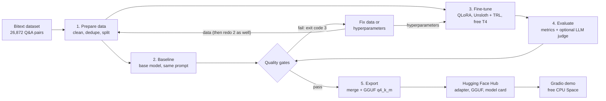

# Customer support assistant: fine-tuning a small open LLM with QLoRA

[](https://github.com/MITRAKER/llm-finetune-support/actions/workflows/ci.yml)
[](https://github.com/MITRAKER/llm-finetune-support/actions/workflows/codeql.yml)
[](LICENSE)
[](pyproject.toml)
[](https://github.com/astral-sh/ruff)
[](https://mypy-lang.org/)
[](.pre-commit-config.yaml)
[](docs/CODING_STANDARD.md)
[](https://www.kaggle.com/notebooks/welcome?src=https://github.com/MITRAKER/llm-finetune-support/blob/main/notebooks/kaggle_pipeline.ipynb)

An end-to-end, reproducible fine-tuning project: a 4-billion-parameter open model
(Qwen3-4B-Instruct-2507) is trained with QLoRA on one **free** GPU to answer
customer-support questions for an online store, measured against the untuned base
model, gated by quality checks, exported to a 4-bit GGUF file and served by a demo
that runs on a free CPU.

The model is trained not to invent store details. Where a phone number, order
number or URL belongs, it writes a placeholder such as `{{Order Number}}`, and the
application fills it from real data. It can still slip, so how often a reply
contains an invented detail is measured and gated.

New to fine-tuning? [LEARNING.md](LEARNING.md) walks through every step: what was
built, why, and the concepts behind it.

## Pipeline



| Step | Script | Runs on | Time on a T4 |
|---|---|---|---|
| 1. Prepare data | `src/prepare_data.py` | CPU | 1 minute |
| 2. Baseline evaluation | `src/evaluate.py --model base` | GPU | about 15 minutes |
| 3. QLoRA fine-tuning | `src/train.py` | GPU | about 3 hours |
| 4. Evaluation and quality gates | `src/evaluate.py --model tuned`, then `--compare` | GPU | about 15 minutes |
| 5. Export to GGUF and upload | `src/export.py [--push]` | GPU | about 20 minutes |
| Demo | `app/app.py` | CPU | |

Times are estimates for the full dataset; run the notebook's quick test first to measure your own.

## Results

The comparison table below is produced by step 4 (`results/REPORT.md`) and copied
into the model card automatically. It will be filled in after the first full
training run on Kaggle.

| Metric | Base model | Fine-tuned | Quality gate |
|---|---|---|---|
| Intent accuracy | _pending_ | _pending_ | at least 0.85, and at least +0.05 over the base model |
| ROUGE-L against the reference answer | _pending_ | _pending_ | at least +0.05 over the base model |
| Invented-detail rate (lower is better) | _pending_ | _pending_ | at most 0.05 |
| Uses placeholders | _pending_ | _pending_ | |
| Out-of-scope prompts: invented-detail rate | _pending_ | _pending_ | at most +0.05 over the base model |
| LLM judge: acceptable as sent (optional) | _pending_ | _pending_ | |
| LLM judge, out-of-scope prompts: acceptable (optional) | _pending_ | _pending_ | at most 0.10 below the base model |

If any gate fails, `evaluate.py --compare` exits with code 3 and lists the reasons.
In a full run the notebook then skips the export: the fix is better data or
hyperparameters, then retraining. The quick test exports anyway, to check that the
export step works, and never uploads.

## Quick start

### Train on a free GPU (Kaggle)

1. Click **Open in Kaggle** above (you need a phone-verified Kaggle account).
2. Set **Accelerator: GPU T4 x2** and **Internet: on**. Optionally add the secrets
   `HF_TOKEN` (to upload the model), `WANDB_API_KEY` (loss curves) and
   `ANTHROPIC_API_KEY` (LLM judge).
3. Run it once with `QUICK_TEST = True` (30 to 40 minutes), then with `False` using
   **Save Version > Save & Run All** so it keeps running after you close the tab.

### Work on the code without a GPU

```bash
git clone https://github.com/MITRAKER/llm-finetune-support.git && cd llm-finetune-support
python -m venv .venv && source .venv/bin/activate
make install                            # dev tools + pre-commit hooks
pip install -r requirements/smoke.txt   # CPU training stack for the end-to-end test
make check                              # lint, format, types, Power of Ten rules, tests with coverage
```

`make check` includes a real training and evaluation run of a tiny random model on
the CPU. That run needs Linux (WSL2 or a Linux container work too): TRL's training
loss uses Triton, which has no macOS or Windows wheels. On a Mac, run
`make check-fast`, which does everything else and needs only `make install`; CI runs
the full check on every pull request.

### Run the steps yourself on a CUDA machine

```bash
python3 -m venv .venv && . .venv/bin/activate      # or a conda environment
make install-train                                 # the GPU stack, with torch built for your driver
make data baseline train evaluate compare export   # or run each script with --config
```

`make install-train` installs `requirements/train.txt` with
`uv pip install --torch-backend=auto`, as the Kaggle notebook does: uv keeps a torch
that already fits and otherwise picks the build that matches your NVIDIA driver. A
plain `pip install -r requirements/train.txt` can replace torch with PyPI's default
build, which uses CUDA 13 and needs driver 580 or newer (`nvidia-smi` shows yours).
It works in a virtual environment, a conda environment or any other Python that pip
can install into. On Debian 12, Ubuntu 23.04 and newer, pip refuses to install into
the system Python (it is "externally managed"), so create a virtual environment
there first, as above.

Every setting lives in [`configs/qwen3_4b_qlora.yaml`](configs/qwen3_4b_qlora.yaml).
One experiment is one config file: copy it to try another model or other hyperparameters.

## How it works

**Data.** The [Bitext customer-support dataset](https://huggingface.co/datasets/bitext/Bitext-customer-support-llm-chatbot-training-dataset)
has 26,872 question-answer pairs over 27 intents (cancel an order, track a refund,
change an address, ...), with placeholders such as `{{Order Number}}`. Step 1
normalizes the text, drops too-short and too-long rows, removes questions that are
identical after lowercasing and removing punctuation (before splitting, so no exact
repeat is in both train and test), and makes a stratified 80/10/10 split by intent.
Row counts after every step go to `data/processed/stats.json`. Because the dataset was
generated from templates, close paraphrases still end up in both splits: about half
of the evaluated test questions differ from a training question by a single word
(often a typo) or only by the word order.

**Model and method.** Qwen3-4B-Instruct-2507 (Apache 2.0) is loaded in 4-bit NF4 and
frozen; LoRA adapters of rank 16 on every attention and MLP projection are trained:
about 33 million weights, under 1% of the model. The loss is computed on the
assistant's answer only. On a T4 training runs in fp16 (the T4 has no fast bf16).
It fits in 15 GB mainly thanks to the 4-bit base model (about 2.5 GB instead of 8)
and Unsloth's gradient checkpointing; the 8-bit optimizer saves only about 0.2 GB
here, because LoRA trains just 33 million weights. The best checkpoint by validation
loss is kept.

**Evaluation.** The base model gets exactly the same system prompt, placeholder
instruction included, so the comparison measures the training and not a better
prompt. On 300 held-out test questions plus 24 hand-written out-of-scope prompts
(off-topic requests, prompt injection, requests for other customers' data,
hallucination bait, abuse, other languages) it measures:

- **Intent accuracy**: a TF-IDF classifier trained on the training answers checks
  that each reply addresses the right request (its accuracy on the reference
  answers is reported too, as a reference point).
- **ROUGE-L**: overlap with the reference answer; a rough signal only.
- **Invented-detail rate**: replies containing a concrete phone number, email, URL,
  long number, code or amount that the customer did not provide.
- **Placeholder use** and **length**.
- Optionally, an **LLM judge** (Claude, through the Anthropic API with structured
  outputs) scores correctness, helpfulness and tone and decides if a support lead
  would send the reply as-is.

The out-of-scope prompts are gated too: fine-tuning must not make the model invent
more details, or decline worse, than the base model does on them.

**Deployment.** The adapter is merged into the base model and converted to a 4-bit
GGUF file (about 2.5 GB) that llama.cpp runs on a CPU. The Gradio app streams replies
and fills placeholders from the store's own details.

## Engineering quality

| Practice | How |
|---|---|
| Continuous integration | Every pull request runs lint, format, type checks, the Power of Ten checker, unit tests on Python 3.11 to 3.13, an end-to-end smoke test that trains a tiny model on the CPU, and a coverage gate of 85% ([ci.yml](.github/workflows/ci.yml)) |
| Coding standard | NASA/JPL "Power of Ten" rules adapted to Python, each one enforced by a tool or by code review ([docs/CODING_STANDARD.md](docs/CODING_STANDARD.md)) |
| Zero warnings | Any warning fails the tests; ruff and mypy must report nothing |
| Security | CodeQL, pip-audit, ruff's bandit rules, gitleaks in pre-commit, least-privilege workflow permissions, secrets only in secret stores |
| Dependencies | Pinned in `requirements/` and audited with pip-audit; Dependabot pull requests must pass CI, and those that touch the GPU stack also need a quick-test run on Kaggle |
| Releases | Semantic versioning, [CHANGELOG.md](CHANGELOG.md), and a tag such as `v0.1.0` publishes a GitHub release ([release.yml](.github/workflows/release.yml)) |
| Continuous deployment | After CI passes on `main`, the demo is published to the Hugging Face Space ([deploy-space.yml](.github/workflows/deploy-space.yml)) |
| Reproducibility | One config per experiment, fixed seeds, pinned versions, and the library versions and git commit saved next to every trained adapter |

## Deploy the demo

1. Run the notebook with `QUICK_TEST = False`, `HUB_MODEL_ID` set and the `HF_TOKEN`
   secret (write access) attached. If the quality gates pass, the GGUF file is
   uploaded to `<HUB_MODEL_ID>-GGUF` on the Hugging Face Hub. The quick test never
   uploads.
2. In this GitHub repository, under **Settings > Secrets and variables > Actions**, add
   the secret `HF_TOKEN` (write access) and the variables `HF_SPACE_ID` (for example
   `your-name/support-bot`) and `HF_MODEL_REPO` (`<HUB_MODEL_ID>-GGUF`).
3. Run the **Deploy demo** workflow on `main` from the Actions tab (or push to
   `main`). It creates the Space if needed and uploads `app/`.

## Cost

Training and evaluation fit in Kaggle's free weekly GPU quota (about 5 of the 30
hours). The optional LLM judge is the only paid part: about $7 per full run with the
default judge model (`claude-opus-5-5`), or about $0.20 with `claude-haiku-5-5`
(set `eval.judge.model` in the config). Everything else is free.

## Repository layout

```text
configs/        one YAML file per experiment
data/           out_of_scope.jsonl (24 tricky prompts); processed data is generated, not committed
src/            the pipeline: prepare_data, train, evaluate, metrics, judge, export, common
app/            Gradio demo for a Hugging Face Space (app.py, requirements.txt, Space card)
notebooks/      kaggle_pipeline.ipynb: the whole pipeline on a free GPU
tests/          unit tests and the CPU smoke test (tiny_model.py builds the tiny model)
tools/          Power of Ten checker, Space deploy and release-notes helpers
docs/           coding standard and the model card template
requirements/   pinned dependencies: base, dev, train (GPU), smoke (CPU CI)
.github/        CI/CD workflows, Dependabot, issue and pull request templates
LEARNING.md     the step-by-step lesson
```

## Limitations

- The training data is synthetic and English-only, so the model is strongest on
  common, single-intent requests in English.
- The test questions come from the same templates as the training questions, and
  many are close paraphrases of one, so the scores measure performance on questions
  like the training ones. Real customers' wording will be harder.
- The automatic metrics are proxies: ROUGE-L rewards wording overlap, and the intent
  classifier only checks the topic. That is why the LLM judge and a manual read of
  `results/*_predictions.jsonl` are part of the evaluation.
- The gates measure the model in its training form (4-bit base plus adapter). The
  GGUF file is the merged model quantized again, which usually costs little quality
  but is not measured separately.
- It is a demo: it has no access to real orders or accounts, and replies about money
  or personal data should always be checked by a person.

## License

The code is MIT licensed ([LICENSE](LICENSE)). The base model is Apache 2.0, and the
fine-tuned weights are released under the same license. The Bitext dataset is
licensed CDLA-Sharing-1.0; this repository does not redistribute it (the pipeline
downloads it from the Hugging Face Hub).

## Contributing and citation

See [CONTRIBUTING.md](CONTRIBUTING.md) for the development workflow and
[SECURITY.md](SECURITY.md) for reporting security problems. If you use this project,
please cite it using [CITATION.cff](CITATION.cff).
